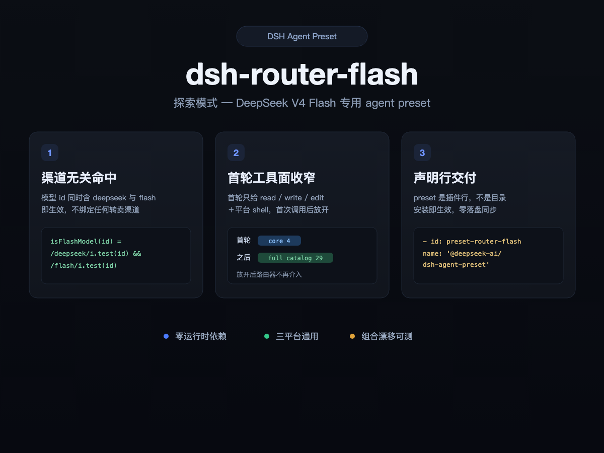
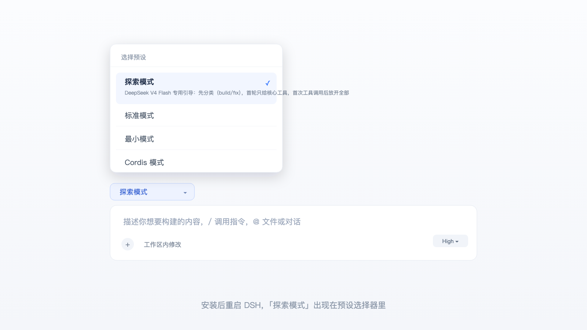
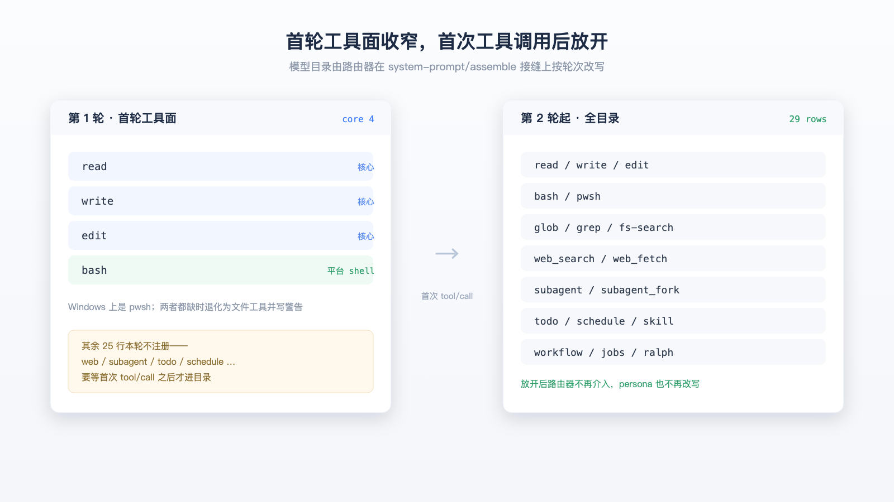

<div align="center">

[English](README.md) | [简体中文](README.zh.md)

</div>

# dsh-router-flash

<div align="center">
  
</div>

## 实际效果 / Actual UI

**预设选择器 / Preset Picker**

<div align="center">
  
</div>

**首轮工具面 / First-turn Tool Face**

<div align="center">
  
</div>

## In one line

An agent preset for DeepSeek V4 Flash in the dsh web GUI — matches on the
model id alone (any channel), narrows the first turn's tool face, then gets out
of the way.

## What it is

A dsh **agent preset** delivered as a bundle patch layer. Installing the
plugin declares one `@deepseek-ai/dsh-agent-preset` row; restart dsh and
「探索模式」 appears in the preset picker. **Nothing is written to disk** — since
DSH 0.2.0 the preset is a plugin row, not a directory.

What it does:

| Stage | Behaviour |
|---|---|
| **Match** | `isFlashModel(id) = /deepseek/i.test(id) && /flash/i.test(id)` — channel-agnostic |
| **Persona** | For Flash, always the weak branch (w7 guidance): classify, review, stay on topic, think deeply, close the loop |
| **First turn** | Only `read` / `write` / `edit` plus the platform shell (`bash`, or `pwsh` on Windows) |
| **After the first `tool/call`** | The full 29-row catalog opens and the router stops touching anything |

The router hooks the `system-prompt/assemble` seam and rewrites the model
catalog by turn. Mode derives from durable session events, so resume/reload
keeps it.

## Match rule (channel-agnostic)

```
isFlashModel(modelId) = /deepseek/i.test(modelId) && /flash/i.test(modelId)
```

| Model id | Match | Route |
|---|---|---|
| `deepseek-v4-flash` | yes | weak (w7 guidance — this preset's main path) |
| `deepseek-v4-flash-0731`, `deepseek-v4-flash-vision-exp` | yes | weak |
| `deepseek-v4-pro`, `deepseek-chat` | no | keyword classification of the first user message (build/fix) |
| `gemini-2.5-flash`, `qwen3-flash`, `gpt-5-flash` | no | same as above |

**Why not match `flash` alone**: that would drag non-DeepSeek models
(`gemini-2.5-flash`, `qwen3-flash`) into this preset's weak persona, which is a
negative optimisation for them. Unmatched models can still use this preset —
they just take the generic classification branch.

**Why not bind to `opencode-go`**: a model's capability comes from the model,
not from who resells it. Any channel's DeepSeek V4 Flash should get the same
guidance; channel differences belong in the `provider` config, not the preset.

## Install

Requires harness ≥ 0.2.0-rc.2 (verified on 0.2.0-rc.2; also running on
0.2.1-rc.1).

```sh
curl -fsSL https://raw.githubusercontent.com/taxueseek/dsh-router-flash/main/install.sh | sh
# restart DSH
```

Manual equivalent:

```sh
dsh plugin --profile web add -w github:taxueseek/dsh-router-flash#v0.4.1
# restart DSH
```

After the restart, the `router-flash` preset shows up in the preset picker
under the display name 「探索模式」. Then point the model at **any channel's**
DeepSeek V4 Flash — what goes in `provider` is your channel's business, and
this preset makes no assumption about it (verified channels below). Model
routing is configured in the profile's `cordis.patch.yml` on the host's
`dsh-agent-default-model` row, or picked directly in the GUI's model selector.
Select 「探索模式」 in a new session.

To make it the **default preset**, override the registry row in the profile's
`cordis.patch.yml` (the preset's default comes from there):

```yaml
- id: agent-preset-registry
  name: '@deepseek-ai/dsh-agent-preset-registry'
  config:
    default: router-flash
```

> Since 0.2.0, `agent-presets.default` in `~/.dsh/settings.yaml` no longer
> exists. If you changed it following older docs, that setting is now neither
> read nor reported — just delete it.

## Upgrade

```sh
dsh plugin --profile web add -w github:taxueseek/dsh-router-flash#v0.4.1
```

After a restart the declaration row is replaced with the patch layer; **there
is no user directory to overwrite**.

**The one step unique to 0.3.x → 0.4.0**: 0.3.x synced preset files into
`~/.dsh/.agent-presets/router-flash/`, a directory that is no longer read on
0.2.0-rc.2 (see 「Version adaptation」). The plugin checks for it at startup and
says so in the log; once you have confirmed the upgrade and restarted, you can
delete it by hand — the plugin itself only does a read-only check and will not
delete it for you.

## Uninstall

```sh
dsh plugin --profile web remove dsh-router-flash
```

After a restart the declaration row disappears with the patch layer and the
preset roster no longer lists it. If a 0.3.x-era directory is still around,
delete it manually.

## Usage

1. After installing, restart dsh and pick 「探索模式」 in a new session's preset
   picker.
2. Submit your task. The persona injects five anchors automatically —
   classification, review, staying on topic, deep thinking, closing the loop.
   **Note the exact behaviour**: for DeepSeek Flash the code does *not*
   classify the task type — it always takes the weak branch, and the
   classification is left to the model reading that line in the persona;
   `classifyTask()`'s keyword classification only serves non-Flash models.
3. After the session starts, the model's system prompt should contain:

   ```
   You are a helpful assistant.
   Before acting, decide the task type (build or fix)...
   Before acting, briefly review what you have already done...
   Do not run environment checks (echo, whoami, uname...)...
   Think deeply about the architecture, edge cases...
   Produce when your information is complete...
   ```

## Cross-platform support

The preset is **platform-agnostic**; dsh picks the shell tool automatically:

| OS | shell | Status |
|---|---|---|
| macOS | bash | measured (this round's verification environment) |
| Linux | bash | not measured; same bash branch |
| Windows | pwsh (PowerShell) | not measured; the `process.platform === 'win32'` check in `presets/router-flash.patch.yml` disables bash and enables pwsh automatically |

> The core routing logic (persona / guidance / model detection) is
> OS-independent. A missing shell is no longer fatal: the turn degrades to
> file tools and logs a warning.

## Compatibility

| dsh-router-flash | Harness | Notes |
| --- | --- | --- |
| 0.4.1 | **0.2.1-rc.1 (current, running)** | Restores `time-context` + `tool-schedule`, aligns `plan-mode` wording, fixes an unreachable `FLASH_NEUTRAL` throw; composition drift 12/12 explained. |
| 0.4.0 | 0.2.0-rc.2 (measured) | Breaking: preset delivered as a declaration row; no more disk sync. |
| 0.3.1 | 0.1.5-rc.2 (historical) | Directory-form preset — **does not exist** on 0.2.0-rc.2. |

Requires Node.js ≥ 22.19 (the floor this package is developed and tested on).

What was actually checked on 0.2.1-rc.1 (this code):

- **The seams still resolve**: `system-prompt/assemble` is still
  `(assembly, context, next)` (`dsh-system-prompt:355`); `assembly.sections` /
  `contexts` / `tools` keep their shape; `session.snapshotEvents()`,
  `tool/call` and `user/message` event names are unchanged.
- **`npm test` is 5/5 green** — the composition check compares against the
  official `standard` preset row by row and requires the difference set to be
  *exactly* the whitelist (12 entries, each with a stated reason).
- **The compatibility gate can now see this bundle**: 24 host packages are
  declared in `peerDependencies` at `^0.2.0-rc.2`. This is not decoration —
  the host reads it to decide bundle compatibility, and a version mismatch
  makes it skip this bundle explicitly in the startup log instead of
  installing it and having nothing take effect (which was 0.3.x's real state
  on rc.2).

## Configuration

The bundle entry carries no host-side `config` block. The one knob lives on
the declaration row itself:

| Key | Default | Effect |
|---|---|---|
| `flashGuidance` | `true` | When `false`, Flash models get a neutral persona sentence instead of the w7 guidance. The spec sentence is never used as a fallback. |

Override by Loader row id in the profile's `cordis.patch.yml`:

```yaml
- id: preset-router-flash
  name: '@deepseek-ai/dsh-agent-preset'
  config: { ...restate the whole config... }   # override is whole-value replacement
```

> Override replaces the whole value: **omit a field and you lose it**, so
> restate `id` / `plugins` along with anything you change.

## Dependencies

- [DeepSeek Harness](https://github.com/deepseek-ai/deepseek-harness) (dsh)
  **0.2.0-rc.2 or newer**. This preset is measured on 0.2.0-rc.2 and
  0.2.1-rc.1; before 0.2.0 presets were directories, which this package no
  longer supports as of 0.4.0.
- Any channel's DeepSeek V4 Flash model (id containing `deepseek` + `flash`).
- Verified channels: `opencode-go` (`https://opencode.ai/zen/go/v1`),
  `tokenrhythm` (`https://tokenrhythm.studio/v1`). Both share one preset; the
  only difference is the `provider` value in model routing.

Zero runtime dependencies: `dependencies` stays empty.

## Tool face: two kinds of restriction, handled differently

`dsh-web-app` (the Web host bundle) sets **23 agent-plane rows to
`disabled: true`** at the host layer, with the comment **「Presets own the
human command and model-facing tool」** — covering `tool-web` / `command-goal`
/ `tool-goal` / `tool-bash` and other model and command entry points. **So in a
Web deployment, one row a preset omits means that capability simply does not
exist for that preset's agent.**

That also yields a rule unrelated to "restriction" but just as fatal: **a row
the host does not declare and only the official presets declare is equally
absent if this preset does not write it.** 0.4.1 restored two rows on that
basis — the nature is **closing a gap**, not adding a preference:

| Restored row | What actually happens without it | Cost |
|---|---|---|
| `time-context` | The model cannot get the current time or timezone and can only guess at "today", "recently", "when was this file changed" | One reading every 10 minutes by default, ~100 characters each — negligible |
| `tool-schedule` | No `schedule_create/list/update/delete`; no timed reminders can be created | 4 tool schemas, visible only after the first turn |

It also reverts `plan-mode`'s opening `section` sentence to the official 0.2.1
wording (`until the user approves your plan through exit_plan_mode`). The old
sentence read `until exit_plan_mode succeeds` — treating "the call succeeded"
as the approval condition, which lets the model leave plan mode without the
user ever agreeing.

Upstream and sibling plugins **restrict this area consistently**:

| Row | godmode / router-standard line | anchored line (apex / anchored-flash / liangshen / anchored-standard) | dsh built-in minimal / ptc / standard / cordis |
|---|---|---|---|
| `tool-web` → `web_fetch` | `fetch: false` (6/6) | `fetch: false` (4/4) | `fetch: true` |
| `command-goal` (`/goal`) | absent (6/6) | absent (4/4) | present |
| `present` (deliverable surfacing) | absent (6/6) | absent (4/4) | present (since 0.1.5-alpha.2) |

But these two restrictions are **different in nature**, so they are handled
differently.

### `web_fetch`: a model-visible subtraction → follow the family, keep `false`

- This is a row the family wrote **deliberately**, not an oversight:
  `dsh-web-app` has disabled the host's `tool-web` row since `0.1.1-rc.2`
  (earlier than the family wrote its file); the family knew the row belonged
  to the preset and still wrote `fetch: false` while keeping `search`.
- It is a **model-visible** subtraction (`web_fetch`'s schema enters the model
  catalog); removing it needs measurement, and none of the 9 presets' docs
  explain this line at all, nor offer any measurement.
- It is **genuinely off**: `dsh-tool-web`'s `apply()` ends with
  `if (resolved.fetch) applyWebFetchTool(...)` — when the condition fails the
  tool is never registered.
- **But a deployment that speaks for itself bypasses it** (measured): if the
  deployment layer writes an explicit `tool-web` row (e.g. `fetch: true`), the
  deployment's value wins and the preset's value does not participate; only
  when nobody speaks does this row amount to "subtracting the host default".
  So this restriction "cannot reach where it should, and subtracts where it
  should not" — it is the family's habit, not a security or measurement
  conclusion.
- This preset keeps `false` (following the family). To enable it: change that
  row's `fetch` to `true` and update the corresponding assertion in
  `test/router.test.mjs`.

### `command-goal`: model-invisible, but still follows the family → not restored

One easy thing to get backwards, so the conclusion first: **not restoring it is
a decision, not an omission.**

- The facts: every version of `dsh-base` carries this row and **enables** it;
  `dsh-web-app` sets it to `disabled: true` from **0.1.2-alpha.2**; the
  official presets add the row in **the same version**. Before that (including
  the upstream family's target versions `0.1.0-rc.6` / `0.1.1-rc.2`) the host
  provided `/goal` directly.
- So the upstream family **neither forgot nor did not want it**: when it wrote
  that comment the host did provide `/goal`, so omitting it was correct at the
  time. The gap only appears when the same preset runs on 0.1.2-alpha.2 or
  later (including this machine's 0.1.5-rc.2).
- Current state (measured on `0.1.5-rc.2`): without the row,
  `commands.list()` = `[compact, feedback, permission, plan]` — i.e. **no
  `/goal`**. With it, `goal` appears.
- Why still not added: although it costs no model context (`dsh-commands`
  registers no prompt section — source checked, so adding it is zero
  disturbance), **adding it departs from the family's tool face**. This
  preset's position is "fix compatibility, do not add taste", and `/goal` is
  taste. All 4 upstream presets omit this row, and this preset stays
  consistent with them.
- To enable it: add the `- id: command-goal` / `name:
  '@deepseek-ai/dsh-command-goal'` pair back to the goals section and update
  the corresponding assertion in `test/router.test.mjs` (which currently
  requires it to be absent).

### `present`: a model-visible addition → follow the family, not restored

- It made it into the official presets, but **only from `0.1.5-alpha.2`** —
  the community family was written earlier, so this is "missed the boat"
  rather than "did not want it".
- Even so it is still a **model-visible** item (~464 characters of
  description), so adding it means changing a catalog the family measured. By
  the same rule (model-visible changes need measurement) it is not added. To
  enable it: add the row back to `agent.cordis.yml` (`- id: present` /
  `name: '@deepseek-ai/dsh-tool-present'`).

### The rule

**The tool face follows the upstream family, adding and removing nothing; only
compatibility problems that actually break are fixed.** What the family wrote
explicitly (`fetch: false`) and what it did not write (`present`,
`command-goal`) are both left alone — including the entries that "look
better", because "looks better" has no measurement behind it, and this
family's entire value comes from its measurements.

`test/router.test.mjs` turns that rule into assertions: the 22 rows the host
hands back must all be present (`command-goal` excepted — it is the decision
above), `command-goal` and `present` must be absent, and `tool-web` must be
`fetch: false`.

## Host ownership handover timeline (goal / present / tool-web)

Ownership of `/goal`, `present` and `web_fetch` moved from the host to the
preset **in batches** across dsh 0.1.x. The actual timeline, checked
version by version against the npm packages:

| Version | `dsh-base` | `dsh-web-app` | Official preset (standard) |
|---|---|---|---|
| `0.1.0-rc.6` ← the upstream family's target | `command-goal` **enabled** | does not touch the row | **no** such row (not needed) |
| `0.1.1-rc.2` | `command-goal` **enabled** | `tool-web` already `disabled` | no `command-goal` row |
| `0.1.2-alpha.2` | `command-goal` enabled | `command-goal` also `disabled` | **adds** the `command-goal` row |
| `0.1.5-alpha.2` | same | same | adds the `present` row |
| `0.1.5-rc.2` | same | all 23 rows `disabled` | all three rows present |
| `0.2.0-rc.2` ← this machine | `command-goal` still enabled | `command-goal` / `tool-ralph` / `tool-web` all `disabled` | all three present (plus `tool-plugin-manager`, `disabled`) |

The key point: **`tool-web`'s handover predates the family writing its file**
(the family knew the row belonged to the preset and still wrote
`fetch: false` — a deliberate trade-off); **`command-goal`'s handover
postdates it** (when the family wrote its comment the host did provide
`/goal`, so its omission was correct then, not an oversight). Different in
nature, handled differently.

The `dsh-command-goal` package itself has existed since `0.0.1-rc.1` — it was
never a new feature. Only "who is responsible for mounting it" changed.

## Version adaptation

The strategy has always been **fix compatibility only, do not touch
behaviour**. Upstream v0.1.0 only adapted to dsh `0.1.0-rc.6` and would
install but not work on `0.1.5-rc.2`.

### 0.2.1 (the 0.4.1 round)

This generation did not change the agent preset contract
(`system-prompt/assemble`, `sections/tools/contexts`, `snapshotEvents()` all
still exist); what changed is **the official presets' composition itself**:

| Deviation | Symptom | Fix |
|---|---|---|
| Official standard adds `time-context` | This preset omits it → the model has no current time and guesses at anything date-related | Add the row (the host Web composition does not declare it; only the preset can) |
| Official standard adds `tool-schedule` | No `schedule_*` tools; no timed reminders | Add the row |
| `plan-mode`'s `section` wording changed | The old sentence `until exit_plan_mode succeeds` treats "the call succeeded" as the approval condition, letting the model leave plan mode without approval | Revert the opening sentence to the official wording, keep the rest verbatim |
| Official removes `tool-ralph` / `tool-subagent-codex` / `-claude-code` | This preset still has all three (ralph still enabled) | Recorded as an `only-here` whitelist entry; keep or drop pending a measurement — untouched this round |

### 0.2.0-rc.2 (the 0.4.0 round)

| Deviation | Symptom | Fix |
|---|---|---|
| The directory-form preset was removed | `$DSH_HOME/.agent-presets/<id>/` is read by nobody (0 hits searching all 288 packages in rc.2's dependency tree; the official migration doc's words: "Nothing reads that directory any more."). **The harshest symptom in practice**: the plugin installs, syncs files on every startup, leaves a roomful of logs — and the preset roster does not contain it at all | Deliver via an `@deepseek-ai/dsh-agent-preset` declaration row in the bundle patch; delete all disk sync |
| Relative module reference in the composition | `name: ./router-bootstrap.mjs` has nowhere to resolve in a declaration row (rc.2 requires assets to resolve from the installed package) | Change to the in-package subpath export `dsh-router-flash/router-bootstrap` (declared in `exports`) |
| `dsh-workflow-worker-thread` was renamed | That package does not exist in rc.2 (→ `dsh-workflow-ptc`), and the row makes the whole preset fail to mount | Rename the row id and package name together |
| persona's `text` key | rc.2's schema only accepts `prefix`; `text` is an undeclared key, measured as "kept but read by nobody" = a dead key | Delete `text`, keep only `prefix` |
| The compatibility gate cannot see this bundle | 0.3.x had empty `dependencies`/`peerDependencies`, so the host had no way to judge its relation to the runtime — this round 6 bundles were blocked for peer mismatch and this one was not among them, **not because it is compatible but because it declared nothing** | Declare 22 host-package peers (`^0.2.0-rc.2`) so the gate can block it |
| README's default-preset recipe | `~/.dsh/settings.yaml` no longer exists on rc.2 | Change to overriding the `agent-preset-registry` row's `config.default` |

Seams measured as **still online**, and therefore unchanged by a single line:
`system-prompt/assemble` is still `(assembly, context, next)`
(`dsh-system-prompt:355`); `assembly.sections` / `contexts` / `tools` keep
their shape; `session.snapshotEvents()`, `tool/call` and `user/message` event
names are unchanged. That is also why this preset's routing logic could move
over as-is.

### 0.1.5-rc.2 (0.3.0's historical adaptation, kept for the record)

| Deviation | Symptom | Fix |
|---|---|---|
| The persona row wrote only `config.text` | `dsh-persona` has required `prefix` since 0.1.5; failing that row's validation rejects the whole preset mount (`agent-preset/invalid`) | Write both `prefix` + `text` (schemastery keeps undeclared keys) so both 0.1.2-rc.1 ~ 0.1.5-rc.2 generations mount. **No longer needed as of 0.4.0** — `text` is gone |
| Reading `session.events` | That property was replaced by `eventAt()` / `snapshotEvents()` in 0.1.2-alpha.4; every turn's prompt assembly threw a TypeError | `sessionEvents()` feature detection: prefer `snapshotEvents()`, fall back to `session.events` |
| persona section position | `AssembledSection` now only has `{ name, text }`, no `order` to set — render order is array order | Upstream's "append after filtering" throws the identity sentence after all the tool descriptions (measured); changed to **in-place replacement** |
| `/goal` command missing | The host stopped providing the row in 0.1.2-alpha.2, so a preset that does not write it has no `/goal` | **Not fixed**: it is a tool-face choice (costs no model context, but adding it departs from the family) — see the 「Tool face」 section |

`contexts: []` keeps the upstream value (both branches empty it): allowing it
would inject a ~470-character runtime context snapshot into every turn
(especially the first), and changing the most sensitive turn needs measurement
that does not exist yet. Deployments that want that visibility should decide
for themselves — that is the deployment's trade-off, not the preset's.

## Known differences from the official `standard`

28 of the 29 leaf rows in `presets/router-flash.patch.yml` point at someone
else's package (97%). So that "upstream changed and this did not follow" can no
longer be silent, the differences are frozen into a table where every entry
needs a reason, enforced by `npm test`: **the difference set against the
official `standard` preset must be exactly the whitelist** — one extra needs
an explanation, one missing must be deleted (anti-rot).

| Row | Nature | Reason |
|---|---|---|
| `router-bootstrap` | only here | the router itself |
| `command-goal` / `present` / `tool-plugin-manager` / `tool-plugin-market` | official only | family tool face: not restored (the first two — see 「Tool face」; the last two belong to the host/deployment layer, and the official rows are themselves `disabled: true`) |
| `persona` | different value | different identity sentence and no `suffix`; this row is only a fallback, replaced wholesale by the router at assembly time |
| `tool-ralph` | only here | official 0.2.1 removed the row entirely; this preset still enables `maxRounds: 64` — **a real difference, keep-or-drop pending a measurement** |
| `tool-subagent` | different value | missing 0.2.0's new `modelSelectionSettings: true` (a model-visible addition, not followed without measurement) |
| `tool-subagent-fork` | different value | this preset adds `backgroundMode: continuable`; official has no such key |
| `tool-subagent-codex` / `-claude-code` | only here | both rows are `disabled: true`, register no tools, and are unobservable |
| `tool-web` | different value | family value `fetch: false` (a model-visible subtraction, not changed without measurement) |

**Differences 0.4.1 already eliminated**: `time-context` and `tool-schedule`
moved from "official only" to "both sides have it" (capability restored), and
`plan-mode`'s `section` wording now matches official verbatim.

One caveat: **"is this config key inside that package's schema" is not in
scope for the offline check** — that schema only exists at runtime. To check
it, use the host's Inspect: `cordis_inspect_query` →
`host/Config/listConfigs {name: "@deepseek-ai/dsh-<package>"}`.

## Runtime robustness

- **No more disk writes**: since 0.4.0 the preset is delivered by the
  composition layer. At startup the plugin does one read-only check (is the
  old `.agent-presets/router-flash` still there) and degrades that single
  thing's failure to a log line — an explanatory plugin must never keep the
  host from booting.
- **A missing shell is no longer fatal**: when the tool catalog has neither
  `bash` nor `pwsh`, the first turn degrades to file tools and logs a warning
  instead of throwing and failing the whole request.
- **A narrower crash surface**: the routing logic depends on only three seams
  (the `system-prompt/assemble` event, the tool catalog, session events); if
  any seam changes it degrades or warns, and never throws through to the whole
  request.

## What was adapted (relative to upstream v0.1.0)

Upstream relied on three mechanisms that were already dead on `0.1.0-rc.6`;
this preset carries over its fixes and adds the 0.1.5 adaptation:

1. `ctx.on('session/event')` injection — session/event is session-scoped, so
   an agent-plane preset never receives it.
2. `target.inbox.append` — the agent object has no `.inbox` property.
3. At assembly time there is no user/message in the events yet — a timing
   problem.

**The fix**: merge the guidance statically into the `WEAK_FLASH` persona and
depend on no dynamic injection mechanism at all.

## Tests

```bash
npm test          # = node test/router.test.mjs && node scripts/check-composition.mjs
```

**`npm install` is not needed**: this package has zero dependencies, and the
check script borrows `js-yaml` and the official preset files from the local
dsh runtime.

- `test/router.test.mjs` — pure logic regression: model detection (DeepSeek
  Flash matches, other families' same-named flash does not), persona in-place
  replacement and deduplication, first-turn tool face (core + platform shell),
  the full catalog opening after the first `tool/call`, runtime context
  preservation, keyword classification, the degradation warning when no shell
  exists, delivery-form self-consistency (declaration row id / `config.id` /
  in-package subpath reference), plus 0.4.1's two additions: the clock row and
  the schedule row must be in the composition, and `flashGuidance:false` must
  fall back to the neutral sentence and never to the spec sentence.
- `scripts/check-composition.mjs` — contract check, four assertions each
  reporting on its own: ① the declaration row is structurally consistent;
  ② every self-reference is provided by `exports` and the file exists;
  ③ every `@deepseek-ai/...` row name in the composition resolves in the
  current dsh runtime (**the net that catches rename drift**); ④ the
  difference set against the official `standard` is exactly the whitelist.
  When dsh cannot be found it reports SKIP explicitly rather than pretending
  to pass; `--strict` upgrades SKIP to FAIL.

## Scope

- Once `isFlashModel` matches, it always takes the weak branch (the author's
  measured optimum, w7).
- Non-DeepSeek-Flash models (e.g. `deepseek-v4-pro`, `gemini-2.5-flash`) take
  the keyword classification path and can still use the preset.
- Complex build tasks (large projects, greenfield development) benefit most
  from the deep-thinking anchor.

## Package layout

```
dsh-router-flash/
├── package.json                     # dsh.bundle (two patches) + dsh.client + 22 peer declarations
├── cordis.patch.yml                 # patch 1: insert the dsh-router-flash host row (legacy-dir check)
├── presets/
│   └── router-flash.patch.yml       # patch 2: the @deepseek-ai/dsh-agent-preset declaration row (the composition, 29 rows)
├── lib/
│   ├── index.js                     # host side: read-only check of the legacy directory, no more disk writes
│   ├── client.js                    # client side: empty placeholder (no browser UI)
│   ├── router-bootstrap.mjs         # the router: assemble hook (persona routing + first-turn tool face)
│   └── router-core.mjs              # pure routing logic: mode detection / persona / tool face (zero dependencies)
├── test/router.test.mjs             # pure-logic self-check
├── scripts/check-composition.mjs    # contract check (structure / references / resolvability / baseline-diff whitelist)
├── install.sh                       # git-channel installer
├── intro.png                        # hero image
├── ui-preset-picker.png             # actual UI: preset picker
└── ui-first-turn-tools.png          # actual UI: first-turn tool face
```

`dsh.bundle.patch` is an **array** (the official `dsh-web-app` uses it the same
way): the host row and the preset declaration each get their own file, so
whichever half changes, that half is the diff.

## Notes

- The host plugin **no longer writes to disk**. 0.3.x used Node's native file
  API to sync the preset directory (to dodge startup ordering); as of 0.4.0
  that entire write path is gone — the preset goes through the composition
  layer and the plugin is left with one read-only check.
- Override the preset by Loader row id (`preset-router-flash`) in the
  profile's `cordis.patch.yml`, replacing the whole `config`; **an override is
  a whole-value replacement, so omitting a field loses it** — restate `id` /
  `plugins` when overriding.
- The row id `preset-router-flash` is the Loader address; `config.id:
  router-flash` is the identity a session remembers. Renaming it would make
  old sessions lose their preset, so it is fixed.

## Credits and provenance

This repository is a derived work. Its content comes from:

| Project | Author | License | Use |
|---|---|---|---|
| [SheberDavid/v4-flash-godmode-opencode-go](https://github.com/SheberDavid/v4-flash-godmode-opencode-go) | SheberDavid | no standalone LICENSE (its README declares it is based on MIT projects) | the direct source of the `presets/` composition and the dsh rc.6 adaptation logic |
| [dsh-router-standard](https://github.com/yjh051108/dsh-router-standard) | yjh051108 | MIT (© 2026 yjh051108) | the origin of the Flash w7 persona, the deep-thinking anchor and the routing research |
| [dsh-routing-suite](https://github.com/yjh051108/dsh-routing-suite) | yjh051108 | MIT | routing research |
| [DeepSeek Harness](https://github.com/deepseek-ai/deepseek-harness) | DeepSeek | MIT | the host framework |

The bundle wrapper this repository adds (`package.json` / `cordis.patch.yml` /
`presets/` / `lib/` / `scripts/`) is new code contributed by this repository.

Full license and derivation-chain details are in [LICENSE](./LICENSE) and
[NOTICE](./NOTICE). DeepSeek is a trademark of DeepSeek; this project is a
community artifact and is not affiliated with DeepSeek.
